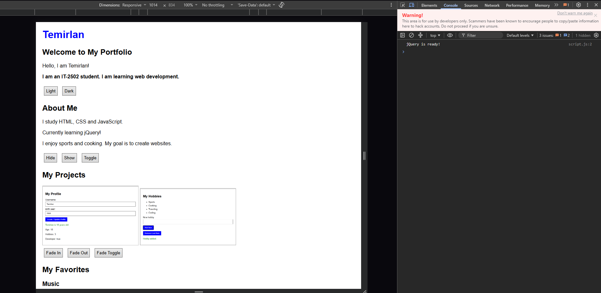
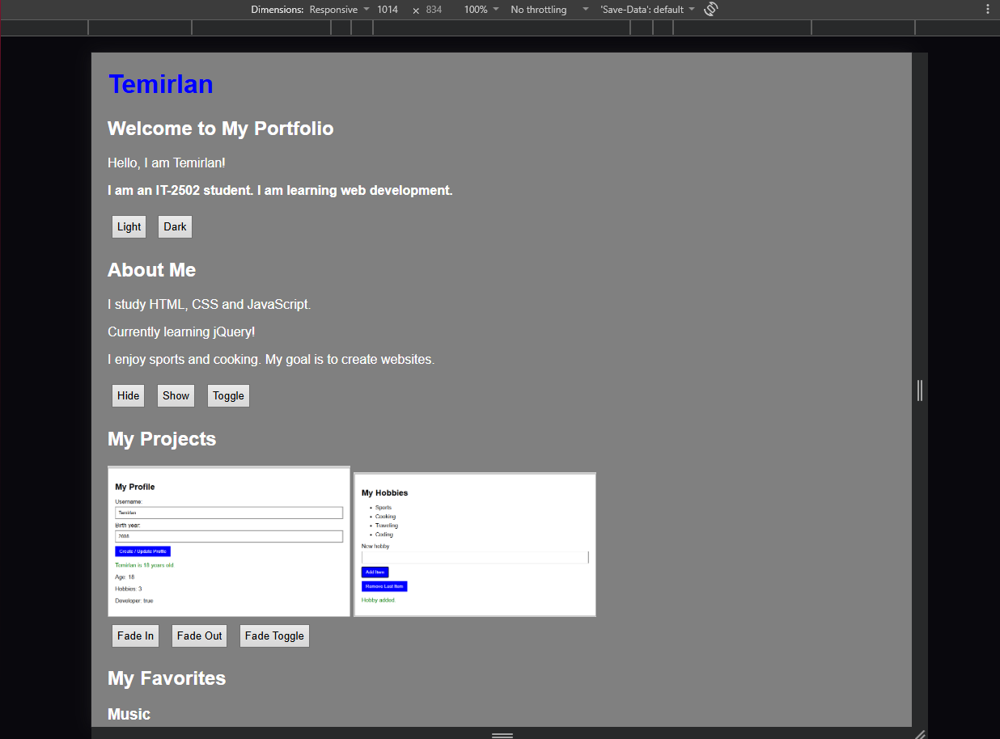
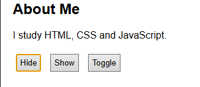
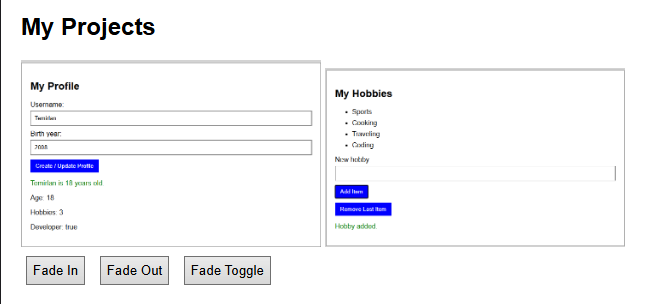
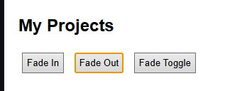
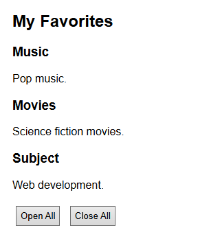
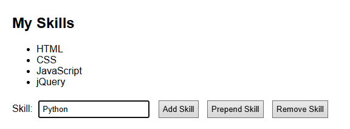
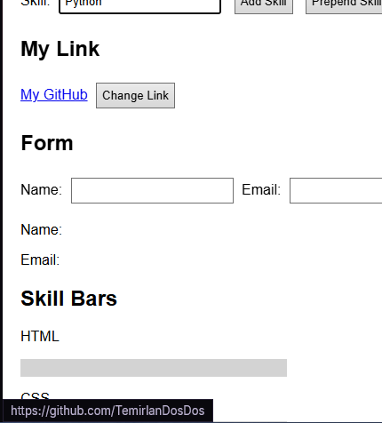
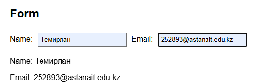
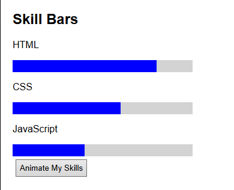

# Assignment 6: jQuery

Name: Temirlan  
Group: IT-2502

Website: https://temirlandosdos.github.io/assignment6/  
GitHub: https://github.com/TemirlanDosDos/assignment6

## Part 1. Getting Started

### Task 0. Setup
jQuery is connected through a CDN. All handlers are inside `$(document).ready()`. The console prints "jQuery is ready!".

### Task 1. Selectors and CSS
The page shows my name and introduction. The tag selector `$("h1")` changes the heading to blue. `$("#greeting")` changes the greeting with `text()`. `$(".intro")` makes the introduction bold. Light and Dark buttons change the background and text colors with `css()`.

## Part 2. Effects

### Task 2. Visibility
About Me contains a biography, status and interests. Hide, Show and Toggle use `hide()`, `show()` and `toggle()` on the status and facts.

### Task 3. Fade
The gallery uses Yandex and Google logos as sample images. The buttons use `fadeIn()`, `fadeOut()` and `fadeToggle()` on both images.

### Task 4. Slide
Music, Movies and Subject are clickable headings. `$(this).next()` selects the paragraph below the clicked heading. `slideToggle()` opens or closes it. Open All uses `slideDown()`, and Close All uses `slideUp()`.

## Part 3. DOM Manipulation

### Task 5. Skills
The initial skills are HTML, CSS, JavaScript and jQuery. `val().trim()` reads the input and removes spaces from its ends. Empty input is ignored. `append()` adds a new list item at the end, `prepend()` adds it at the beginning, and `last().remove()` removes the last item. `text()` puts the entered skill into the new item.

### Task 6. Attributes
My Link initially opens my GitHub profile. Change Link uses `attr("href", ...)` to change its destination to my Assignment 5 repository. The link text also changes to "Assignment 5".

### Task 7. Form
The Name and Email fields have `input` event handlers. `val()` reads each value, and `text()` displays it below the form while typing. `preventDefault()` prevents submitting and reloading the page. No data is sent to a server.

## Part 4. Animations

### Task 8. Skill Bars
The HTML, CSS and JavaScript bars start at zero width. Animate My Skills uses `animate()` to increase their widths to 80%, 60% and 40%. The variable `expanded` stores whether the bars are filled. Clicking again animates them back to zero. The percentages are example values.

## Work process
First, the HTML sections, inputs and buttons were added. Basic CSS sets the font, colors, spacing and bar sizes. The JavaScript file contains jQuery handlers for each task. The project uses plain HTML, CSS and JavaScript without a build step. Gallery images are stored in the project. jQuery requires internet access.
